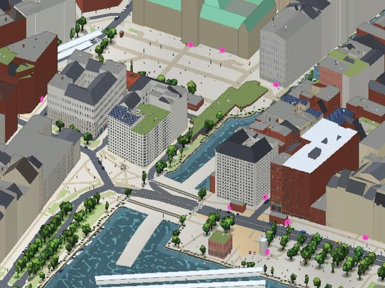
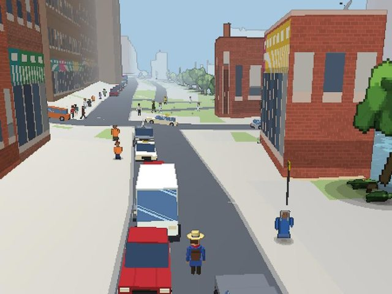
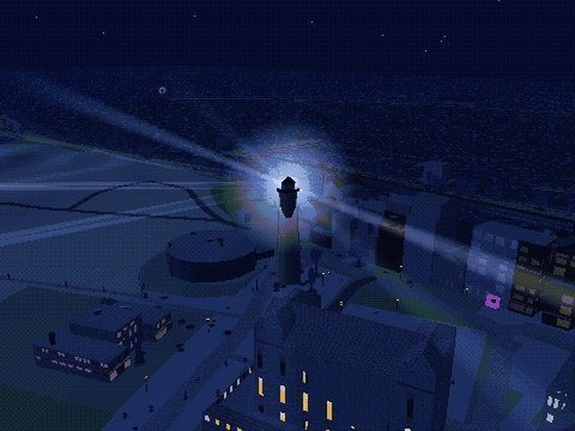

# HoodExplorer

Eine begehbare Pixel-Welt für jeden Ort in Deutschland – live im Browser gebaut, nur aus offenen Daten.

**[▶ Live ausprobieren](https://hoodexplorer.github.io/hoodexplorer/)** · **[Funktionen und Technik (Infoseite)](https://hoodexplorer.github.io/hoodexplorer/info.html)**

  
  
  

## So funktioniert's

Für jede Kachel (etwa 1 km) fließen acht offene Datenquellen zusammen. Regeln entscheiden, welche Quelle gilt, und füllen Lücken – überall dieselben Regeln, keine Einzelfälle.

## Technik

- **Architektur:** statische Seite (GitHub Pages), three.js (WebGL); ein Web Worker baut die Kacheln, ein zweiter holt den Nahverkehr
- **Darstellung:** Details im Shader statt als Geometrie (Fassaden, Dächer, Felder, Hecken, Wasser, Nässe, Licht), Instancing für Bäume, Autos, Passanten und Tiere, Pixel-Nachbearbeitung mit Kanten und Paletten
- **Daten:** Vektorkacheln (MVT) plus eigene Binärkacheln aus dem OSM-Auszug (Python/osmium), begrenzter IndexedDB-Zwischenspeicher
- **Modelle:** Figuren, Tiere, Fahrzeuge und Welt-Modelle werden in Blender per Code gebaut
- **Robust:** fehlt eine Quelle, greift die nächste Stufe; ein Ausfall-Simulator prüft das

### Was auf dem Bildschirm passiert

Gemessen am Hamburger Jungfernstieg (Verfolgerkamera, Fenster 1351 × 1197):

| | |
|---|---|
| Bilder pro Sekunde | 60 |
| berechnete Pixel | 451 × 399 (1/9 – Pixel-Look) |
| Zeichenaufrufe / Dreiecke je Bild | ≈ 150 / ≈ 390 000 |
| Instanzen je Bild | ≈ 5 500 |
| Bäume und Büsche (Sprites) | ≈ 68 000 |
| Gebäude / parkende Autos geladen | ≈ 5 400 / ≈ 5 000 |
| Autos im Verkehr / Passanten / Tiere | 32 / 45 / 75 |
| Busse und Bahnen (Echtzeit) | 8 |

## Funktionen

- **Ganz Deutschland aus offenen Daten** – Ort suchen und losgehen: echte Straßen, Gebäude mit echten Dachformen, Gelände mit Brücken und Unterführungen, Gewässer, Felder, Wälder, Friedhöfe, Kirchen, Burgen, Leuchttürme
- **Zu Fuß und am Steuer** – laufen, springen, einsteigen: vom Kleinwagen über Handwerker-Transporter und Bus bis zu Streifenwagen, Feuerwehr und Notarzt mit Blaulicht und Sirene; Autopilot fährt gespeicherte Strecken ab
- **Lebendige Stadt** – simulierter Verkehr, echter Nahverkehr nach Fahrplan und Echtzeit, parkende Autos, Passanten, Tauben, Möwen, Fische, Ratten und Katzen, Bäume im Wind
- **Stimmungen und Wetter** – zehn Stimmungen (Tageszeiten, Sternennacht, Nebel, Sin City, Matrix, Handheld …), Regen, Gewitter, Schnee, Glatteis mit Pfützen; nachts Laternen, Fenster und Leuchtfeuer
- **Vier Welten** – dieselbe Karte als Heute, Western, Cyberpunk oder Mittelalter
- **Figuren** – 31 Rollen und ein Figuren-Editor
- **Ton** – Schritte je Untergrund, Wasser, Wetter, Motor und Sirene, Lautstärke je Bereich
- **Karte, Orte und Strecken** – Minimap, große Karte mit Ebenen, Ortssuche, gespeicherte Orte und Strecken
- **Sammeln** – Münzkisten, Inventar, Fahrzeugwahl

Alle Einstellungen im Überblick: **[Infoseite → Einstellungen](https://hoodexplorer.github.io/hoodexplorer/info.html#einstellungen)**

## Quellen und Lizenzen

| Daten | Quelle | Lizenz |
|---|---|---|
| Karte, Gebäudeumrisse, Merkmale | © OpenStreetMap-Mitwirkende (OpenFreeMap, Geofabrik) | ODbL |
| 3D-Gebäude (LoD2) | basemap.de / BKG | dl-de/by-2-0 |
| Baujahr | Zensus 2022, Statistisches Bundesamt | dl-de/by-2-0 |
| Gelände | Terrain Tiles (Mapzen, AWS Open Data) | SRTM, EU-DEM u. a. |
| Baumdichte | ESA WorldCover 2021 | CC BY 4.0 |
| Luftbilder (nur Dachfarbe gemessen) | Landesvermessungen der Bundesländer | je Land |
| Nahverkehr | Transitous (offene DELFI-Daten) | freie Nutzung, nicht-kommerziell |
